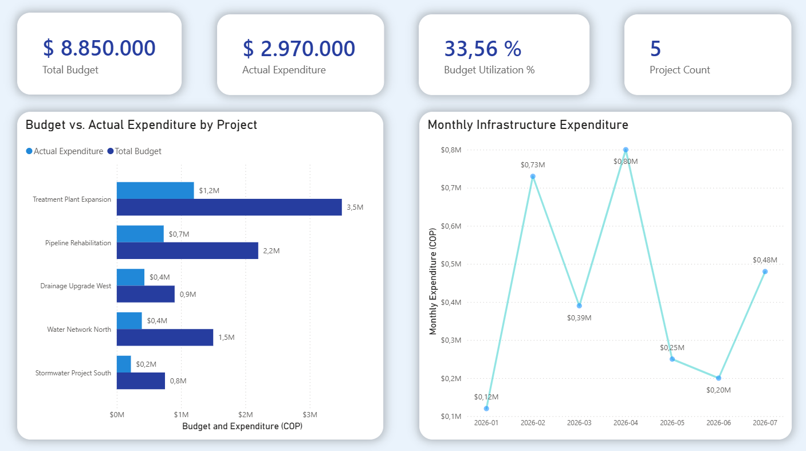
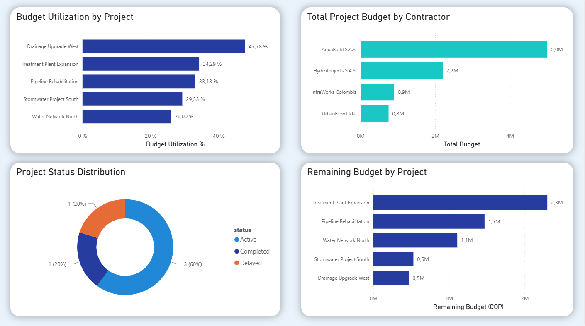

# Infrastructure Project Financial Analytics

An end-to-end analytics solution for monitoring infrastructure project budgets, expenditures, contractor allocations, and project status using Databricks SQL, Delta Lake, and Power BI.

## Business Problem

Infrastructure consulting and project-management teams need visibility into project costs, budget utilization, contractor allocations, and schedule status. Without consistent data validation and consolidated reporting, comparing project performance and identifying areas requiring attention can be difficult.

This project demonstrates a data pipeline and analytics solution that transforms raw project and expense records into structured, reporting-ready data.

## Solution

The solution uses Databricks SQL to validate, clean, and transform project and financial data, then organizes the outputs into a dimensional model consumed by Power BI.

The dashboard supports:
- Portfolio-level budget and expenditure monitoring.
- Budget-versus-actual comparisons by project.
- Monthly expenditure trend analysis.
- Budget utilization and remaining-budget comparisons.
- Contractor budget allocation analysis.
- Project status monitoring.

## Architecture

**Raw Data → Data Quality → Clean Data → SQL Transformations → Gold Data Model → Power BI**

## Technology Stack

- **Databricks SQL / Spark SQL** — data quality, transformations, aggregations, and analytical views.
- **Delta Lake** — persistent analytical tables and an incremental `MERGE` demonstration.
- **Dimensional modeling** — project, contractor, and date dimensions; expense and project-performance fact tables.
- **Power BI** — DAX measures, data modeling, and interactive dashboards.
- **Git and GitHub** — version control and project documentation.

## Data Model

| Table | Grain |
|---|---|
| `dim_project` | One row per project |
| `dim_contractor` | One row per contractor |
| `dim_date` | One row per calendar date |
| `fact_expenses` | One row per expense |
| `fact_project_performance` | One row per project |

## Data Validation

The sample dataset contains:
- 5 projects.
- 4 contractors.
- 14 expense records in the original sample.
- 365 calendar-date records.
- 5 project-performance records.

Expense validation rules identify invalid records before they enter the clean expense layer. The analytical model was checked for the expected row counts and key uniqueness.

## Business Results & Impact

### Business Problem

Infrastructure project teams need to monitor budget consumption, expenditures, contractor allocations, and project status across multiple projects. This solution consolidates these indicators into a structured analytical model and interactive dashboard.

### Analytical Results

Based on the sample dataset:

- **Portfolio budget:** COP 8,850,000.
- **Recorded expenditure:** COP 2,970,000.
- **Overall budget utilization:** 33.56%.
- **Projects analyzed:** 5.
- **Contractors analyzed:** 4.

The analysis also identifies:

- **Highest budget utilization:** Drainage Upgrade West, at 47.78%.
- **Largest project budget:** Treatment Plant Expansion, at COP 3,500,000.
- **Highest monthly expenditure:** April 2026, at COP 800,000.
- **Project status distribution:** 3 active, 1 completed, and 1 delayed.

### Business Value

The dashboard helps users:

- Compare planned budgets with recorded expenditures.
- Identify projects with higher budget utilization for further review.
- Monitor monthly expenditure patterns.
- Compare budget allocation across contractors.
- Review remaining budgets and project status in one reporting interface.

These outputs support financial monitoring and prioritization of further investigation. They do not establish that a project is over budget or that a contractor is underperforming.

### Scope and Limitations

This portfolio project uses sample data. The figures demonstrate the analytical workflow and dashboard capabilities; they are not evidence of actual savings or measured operational improvements.

Schedule status is based on the project's configured reference date, and the incremental `MERGE` demonstration is not yet integrated into the complete clean-data-to-Gold pipeline.

## Interactive Power BI Dashboard

Explore the interactive report in your browser:

[**Open the Infrastructure Project Financial Analytics Dashboard →**](https://app.powerbi.com/view?r=eyJrIjoiY2FhZDIwYmQtZmUxNC00NTAwLTlkZjktODk1ODlkMDQ0ZDY5IiwidCI6ImRhZjc5OTBlLThhM2YtNDA5Yy05Yjc2LTJhNTQ3NTA5ODAwMCIsImMiOjR9)

### Executive Overview

### Project and Contractor Analysis

The dashboard provides visibility into project budgets, actual expenditure, budget utilization, monthly spending, contractor allocations, and remaining budgets.

To inspect the report file locally, see the [Power BI report (.pbix)](powerbi/Infrastructure_Project_Financial_Analytics.pbix).

## Project Structure

- `notebooks/` — Databricks notebooks.
- `sql/` — SQL transformations and validation queries.
- `powerbi/` — Power BI report and dashboard screenshots.
- `docs/` — architecture and technical documentation.
- `tests/` — data-quality and validation tests.

## Future Improvements

- Integrate incremental ingestion and `MERGE` processing into the end-to-end pipeline.
- Automate data-quality tests and pipeline execution.
- Extend schedule analysis with actual completion dates and project milestones.
- Document refresh orchestration and deployment.
